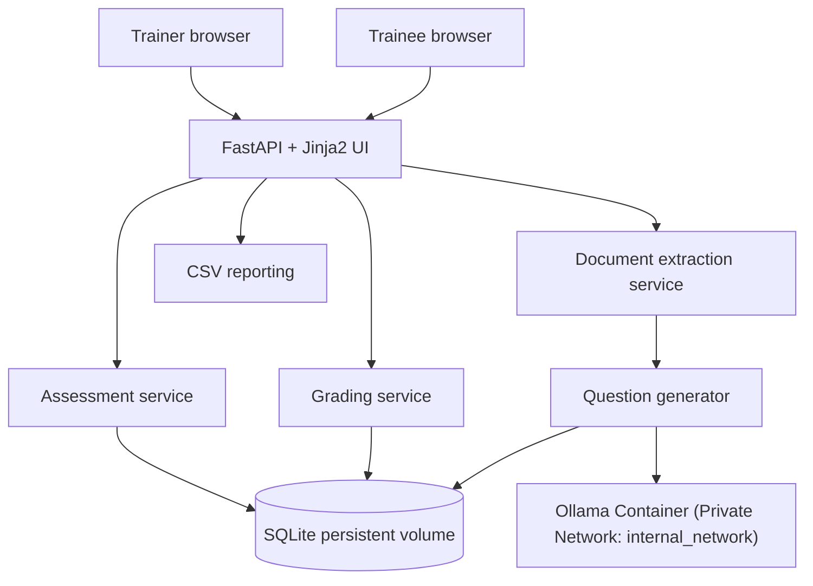

# Training Assessment AI Agent

A trainer-reviewed MCQ assessment web app built with Python 3.12, FastAPI, Jinja2, SQLAlchemy/SQLite, and Ollama (locally hosted Qwen model). It supports PDF, PPTX, DOCX, TXT, and Markdown source material, draft editing, secure published links, deterministic server-side grading, duplicate-submission prevention, exam timer with auto-completion, trainee email whitelist restrictions, progress tables, and CSV export.

## What is included

- `app/main.py`: web routes, trainer login, CSRF checks, generation/publish/submit flows, exam timer, and email restriction checks.
- `app/question_generator.py`: Ollama REST API (`/api/chat`) structured-output generation with JSON schema enforcement and bounded retries.
- `app/document_service.py`: source text extraction; scanned PDFs requiring OCR are rejected with a clear message.
- `app/schemas.py`: Pydantic validation of question and option structures.
- `app/assessment_service.py`, `app/grading_service.py`, `app/report_service.py`: publishing, secure token hashing, grading, CSV.
- `app/models.py`, `app/database.py`: SQLite persistence under `/app/data` in Docker.
- `app/templates/`, `app/static/`: responsive trainer and trainee UI.
- `tests/`: offline unit tests; mocked Ollama HTTP calls.
- `scripts/check_ollama_connection.py`: live Ollama connectivity and model check that safely tests generation without exposing secrets.

## Requirements

- Docker Engine and Docker Compose plugin (recommended for deployment).
- Ollama service running locally or as a container (provided in `compose.yaml`).
- Sufficient compute resources (GPU or CPU with adequate RAM) to run the selected Qwen model (e.g., `qwen2.5:7b` requires ~5GB of RAM/VRAM).
- Python 3.12 (if running locally without Docker).

## Run locally without Docker

Use Python 3.12 and ensure Ollama is installed and running (`ollama serve`):

```bash
# Pull the desired model in Ollama
ollama pull qwen2.5:7b

# Setup Python environment
python3.12 -m venv .venv
source .venv/bin/activate
python -m pip install --upgrade pip
pip install -r requirements.txt
cp .env.example .env

# Generate secret key
python -c 'import secrets; print(secrets.token_urlsafe(48))'
# Put the generated value into APP_SECRET_KEY in .env.
# Set OLLAMA_BASE_URL (defaults to http://localhost:11434)
# Set OLLAMA_MODEL (defaults to qwen2.5:7b)
# Set a strong APP_ADMIN_PASSWORD in .env.

set -a; source .env; set +a
uvicorn app.main:app --host 127.0.0.1 --port 8000
```

Open `http://127.0.0.1:8000`. Trainer routes redirect to `/login`; use `APP_ADMIN_PASSWORD` from `.env`. The database defaults to `./data/assessment.db` for local runs.

## Docker Compose deployment on Ubuntu EC2

### 1. Check instance resources and OS

```bash
lsb_release -a
uname -a
free -h
df -h
nproc
```

### 2. Install Docker if needed

For Ubuntu, the distro package is a simple starting point:

```bash
sudo apt-get update
sudo apt-get install -y docker.io docker-compose-v2
sudo systemctl enable --now docker
docker --version
docker compose version
sudo docker run --rm hello-world
```

If `docker-compose-v2` is unavailable for your Ubuntu release, use Docker's official Ubuntu installation instructions to install Docker Engine and the Compose plugin. Log out/in after adding your user to the `docker` group; otherwise run Docker commands with `sudo`.

### 3. Copy the project to EC2 and configure secrets

Upload/copy this directory to the EC2 host, then:

```bash
cd training-assessment-agent
cp .env.example .env
chmod 600 .env
python3 -c 'import secrets; print(secrets.token_urlsafe(48))'
```

Edit `.env` and set at minimum:

```dotenv
OLLAMA_BASE_URL=http://ollama:11434
OLLAMA_MODEL=qwen2.5:7b
OLLAMA_TIMEOUT_SECONDS=120
APP_ENV=production
APP_SECRET_KEY=replace_with_output_from_secrets_token_urlsafe
APP_ADMIN_PASSWORD=replace_with_a_long_unique_password
SESSION_HTTPS_ONLY=true
```

Ensure `OLLAMA_MODEL` matches the model you pull in step 4. Do not paste secrets into source files, Git, or chat.

### 4. Build, start, and pull model

```bash
docker compose config
docker compose build --pull
docker compose up -d
docker compose ps

# Pull the Qwen model inside the Ollama container (port 11434 is private to internal_network)
docker compose exec ollama ollama pull qwen2.5:7b

docker compose logs --tail=100 assessment-app
curl --fail http://127.0.0.1:8000/health
```

> **Security Note:** Port `11434` is **not** exposed on the host machine or public internet. The `compose.yaml` configuration binds Ollama exclusively to the private Docker bridge network (`internal_network`), accessible solely by `assessment-app` at `http://ollama:11434`.

The default Compose mapping for the web app is `127.0.0.1:8000:8000`: only processes on the host can connect directly, which is appropriate behind an Nginx reverse proxy or SSH tunnel. For temporary direct testing only, change it to `8000:8000` and restrict inbound security-group access to your IP. For real users, use HTTPS through a reverse proxy or load balancer; do not expose the plain HTTP app directly to the public internet.

To open the UI from your local computer while keeping the port private, run this on your computer:

```bash
ssh -i /path/to/key.pem -L 8000:127.0.0.1:8000 ubuntu@EC2_PUBLIC_IP
```

Then open `http://127.0.0.1:8000` in your browser. Replace `ubuntu` with your EC2 login user as appropriate.

### 5. Verify Ollama connectivity and model generation

Run the safe connectivity diagnostic script inside the running container:

```bash
docker compose exec assessment-app python scripts/check_ollama_connection.py
```

This verifies that the assessment app can reach Ollama over the private network, validates that the model is loaded, and performs a minimal dry-run generation without exposing secrets.

## Tests and validation

Offline unit tests use mocked Ollama HTTP responses and do not require a live Ollama daemon:

```bash
python -m pip install -r requirements.txt
python -m py_compile app/*.py scripts/*.py tests/*.py
pytest -v
```

Compose/build validation:

```bash
docker compose config
docker compose build
```

## Main workflow

1. Trainer logs in.
2. Trainer enters a topic, source notes or uploads training material, sets question count, difficulty, trainee email whitelist, and optional exam duration.
3. The local Ollama Qwen model generates a structured JSON draft using only the supplied source as evidence.
4. Trainer edits questions, options, correct answers, and explanations, then saves and approves.
5. Publish creates a cryptographically random link. Only its SHA-256 hash is stored; the raw link is shown once and can be rotated to invalidate the prior link.
6. Trainees access the link, enter their whitelisted email, and start the timed assessment.
7. Trainees submit answers or are auto-submitted when the timer expires. The server deterministically grades against the stored answer key; client-supplied scores are never accepted. A unique constraint prevents duplicate submissions for the same email.
8. Trainer reviews submissions and exports CSV.

## Troubleshooting

- **Login is not configured:** set `APP_ADMIN_PASSWORD` and restart with `docker compose up -d --force-recreate`.
- **Session errors after deployment:** set a stable random `APP_SECRET_KEY`; all replicas must share it. Use HTTPS and `SESSION_HTTPS_ONLY=true` when behind correctly configured TLS.
- **Ollama connection failure:** confirm the `ollama` service is healthy (`docker compose ps`). Check that `OLLAMA_BASE_URL` in `.env` is set to `http://ollama:11434` for Docker Compose or `http://localhost:11434` for local runs.
- **Ollama model not found (404):** pull the model in the Ollama container (`docker compose exec ollama ollama pull qwen2.5:7b`) and ensure `OLLAMA_MODEL` in `.env` matches the pulled tag.
- **Generation timeout:** local LLM inference speed depends on host hardware (CPU/GPU). If generation times out on larger source materials, increase `OLLAMA_TIMEOUT_SECONDS` (e.g. 180 or 300) in `.env` and restart.
- **Missing dependency/import:** `docker compose build --no-cache && docker compose up -d` and inspect `docker compose logs --tail=200`.
- **Port already in use:** `sudo ss -ltnp | grep ':8000'`; change the host-side port in Compose if necessary.
- **Cannot connect externally:** with the default binding, external access is intentionally blocked. Use SSH tunnel/reverse proxy, or temporarily publish `8000:8000` with a narrowly scoped security-group rule.
- **Database permission error:** named volume is `assessment_data`; inspect `docker compose exec assessment-app id` and `docker volume ls`. Avoid changing ownership blindly on a live volume.
- **Syntax error:** `python -m py_compile app/*.py scripts/*.py tests/*.py`; then review the reported filename and line.

## Rollback Procedure

To roll back from the `ollama` branch to `dev` (or a prior release):

1. **Stop active containers:**
   ```bash
   docker compose down
   ```
2. **Checkout the target branch:**
   ```bash
   git checkout dev
   ```
3. **Restore environment variables:**
   Review and update `.env` with the original configuration (e.g. restoring `OPENAI_API_KEY` and `OPENAI_MODEL`).
4. **Rebuild and restart containers:**
   ```bash
   docker compose build --no-cache
   docker compose up -d
   ```
5. **Verify health:**
   ```bash
   docker compose ps
   curl --fail http://127.0.0.1:8000/health
   ```
6. **(Optional) Database rollback:**
   If a schema change was made, restore the database snapshot from `backups/`:
   ```bash
   docker compose stop assessment-app
   docker run --rm -v training-assessment-agent_assessment_data:/data -v "$PWD/backups:/backup" alpine sh -c 'cp /backup/<backup-file>.db /data/assessment.db'
   docker compose up -d assessment-app
   ```

## Backup and upgrades

Back up SQLite before changing versions or schema:

```bash
mkdir -p backups
docker compose stop assessment-app
docker run --rm -v training-assessment-agent_assessment_data:/data -v "$PWD/backups:/backup" alpine sh -c 'cp /data/assessment.db /backup/assessment-$(date +%Y%m%d-%H%M%S).db'
docker compose up -d
```

The volume name may be prefixed by your Compose project name; confirm it with `docker volume ls`. Store backups encrypted and restrict access because they contain trainee identifiers and results. Restore only with the app stopped and after preserving the current database.

## Data retention and limitations

- The app stores assessment source text, question keys, trainee name/identifier, answers, scores, and timestamps in SQLite. Define a retention period appropriate to your organization and delete old data/backups securely.
- OCR is not implemented. Scanned/image-only PDFs are rejected with an explicit message.
- The time limit is enforced against a signed browser session timestamp; it is a baseline control, not a high-assurance proctoring system. Server-side session persistence across devices is not implemented.
- Trainer access uses one shared password rather than individual accounts, roles, MFA, or password reset. Add enterprise identity management before broad production use.
- Add rate limiting at a reverse proxy, audit logging, database migrations, automated encrypted backups, monitoring, and security review before handling sensitive/high-volume assessments.
- No email delivery is implemented; trainer shares the assessment URL manually.
- Model output can still contain mistakes. Trainer review before publishing is mandatory.

## Architecture



## Production hardening checklist

- [ ] HTTPS reverse proxy/load balancer and security-group least privilege.
- [ ] Individual trainer identities, MFA/SSO, and authorization per assessment.
- [ ] Reverse-proxy rate limiting and request-size limits.
- [ ] Database migration strategy and encrypted, tested backups.
- [ ] Retention/deletion policy and privacy notice.
- [ ] Monitor errors, API costs, rate limits, and container health.
- [ ] Validate configured model access and API billing.
- [ ] Review accessibility and security with representative users.
