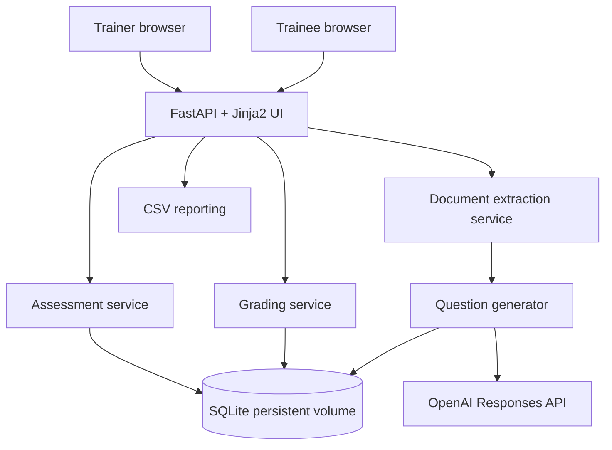

# Training Assessment AI Agent

A trainer-reviewed MCQ assessment web app built with Python 3.12, FastAPI, Jinja2, SQLAlchemy/SQLite, and the official OpenAI Python SDK. It supports PDF, PPTX, DOCX, TXT, and Markdown source material, draft editing, secure published links, deterministic server-side grading, duplicate-submission prevention, progress tables, and CSV export.

## What is included

- `app/main.py`: web routes, trainer login, CSRF checks, generation/publish/submit flows.
- `app/question_generator.py`: OpenAI Responses API structured-output generation and bounded retries.
- `app/document_service.py`: source text extraction; scanned PDFs requiring OCR are rejected with a clear message.
- `app/schemas.py`: Pydantic validation of question and option structures.
- `app/assessment_service.py`, `app/grading_service.py`, `app/report_service.py`: publishing, secure token hashing, grading, CSV.
- `app/models.py`, `app/database.py`: SQLite persistence under `/app/data` in Docker.
- `app/templates/`, `app/static/`: responsive trainer and trainee UI.
- `tests/`: offline unit tests; no real OpenAI calls by default.
- `scripts/check_openai_connection.py`: optional live API connectivity/model check that never prints the API key.

## Requirements

- Docker Engine and Docker Compose plugin (recommended for EC2).
- An OpenAI API key with API billing and access to the selected model. A ChatGPT subscription does not itself include API credits.
- The configured model name must be available to your API project. `gpt-6-luna` is kept as the requested starting value, not a guarantee of model availability.

## Run locally without Docker

Use Python 3.12. From the repository root:

```bash
python3.12 -m venv .venv
source .venv/bin/activate
python -m pip install --upgrade pip
pip install -r requirements.txt
cp .env.example .env
python -c 'import secrets; print(secrets.token_urlsafe(48))'
# Put the generated value into APP_SECRET_KEY in .env.
# Set OPENAI_API_KEY and a model accessible to your API project.
# Set a strong APP_ADMIN_PASSWORD in .env.
set -a; source .env; set +a
uvicorn app.main:app --host 127.0.0.1 --port 8000
```

Open `http://127.0.0.1:8000`. Trainer routes redirect to `/login`; use `APP_ADMIN_PASSWORD` from `.env`. The database defaults to `./data/assessment.db` for local runs.

## Docker Compose deployment on Ubuntu EC2

### 1. Check instance resources and OS

```bash
lsb_release -a
uname -a
free -h
df -h
nproc
```

### 2. Install Docker if needed

For Ubuntu, the distro package is a simple starting point:

```bash
sudo apt-get update
sudo apt-get install -y docker.io docker-compose-v2
sudo systemctl enable --now docker
docker --version
docker compose version
sudo docker run --rm hello-world
```

If `docker-compose-v2` is unavailable for your Ubuntu release, use Docker's official Ubuntu installation instructions to install Docker Engine and the Compose plugin. Log out/in after adding your user to the `docker` group; otherwise run Docker commands with `sudo`.

### 3. Copy the project to EC2 and configure secrets

Upload/copy this directory to the EC2 host, then:

```bash
cd training-assessment-agent
cp .env.example .env
chmod 600 .env
python3 -c 'import secrets; print(secrets.token_urlsafe(48))'
```

Edit `.env` and set at minimum:

```dotenv
OPENAI_API_KEY=your_real_api_key
OPENAI_MODEL=gpt-6-luna
APP_ENV=production
APP_SECRET_KEY=replace_with_output_from_secrets_token_urlsafe
APP_ADMIN_PASSWORD=replace_with_a_long_unique_password
SESSION_HTTPS_ONLY=true
```

Verify the model exists and is enabled for your API project before relying on it. If unavailable, change `OPENAI_MODEL` to a model that your project can use. Do not paste secrets into source files, Git, or chat.

### 4. Build and start

```bash
docker compose config
docker compose build --pull
docker compose up -d
docker compose ps
docker compose logs --tail=100 assessment-app
curl --fail http://127.0.0.1:8000/health
```

The default Compose mapping is `127.0.0.1:8000:8000`: only processes on the EC2 host can connect directly, which is appropriate behind an Nginx reverse proxy or SSH tunnel. For temporary direct testing only, change it to `8000:8000` and restrict inbound security-group access to your IP. For real users, use HTTPS through a reverse proxy or load balancer; do not expose the plain HTTP app directly to the public internet.

To open the UI from your local computer while keeping the port private, run this on your computer:

```bash
ssh -i /path/to/key.pem -L 8000:127.0.0.1:8000 ubuntu@EC2_PUBLIC_IP
```

Then open `http://127.0.0.1:8000` in your browser. Replace `ubuntu` with your EC2 login user as appropriate.

### 5. Verify OpenAI connectivity (optional, uses API quota)

This command makes one live API request and may incur API charges:

```bash
docker compose exec assessment-app python scripts/check_openai_connection.py
```

If the script is not present in the image due to a prior Docker build, rebuild with `docker compose build --no-cache && docker compose up -d`.

## Tests and validation

Offline tests do not call OpenAI:

```bash
python -m pip install -r requirements.txt
python -m py_compile app/*.py scripts/*.py
pytest -q
```

Compose/build validation:

```bash
docker compose config
docker compose build
```

## Main workflow

1. Trainer logs in.
2. Trainer enters a topic and source notes or uploads training material.
3. The model generates a draft using only the supplied source as evidence.
4. Trainer edits questions, options, correct answers, and explanations, then saves and approves.
5. Publish creates a cryptographically random link. Only its SHA-256 hash is stored; the raw link is shown once and can be rotated to invalidate the prior link.
6. Trainees submit answers. The server grades against the stored answer key; client-supplied scores are never accepted. A unique constraint prevents a second submission for the same identifier and assessment.
7. Trainer reviews submissions and exports CSV.

## Troubleshooting

- **Login is not configured:** set `APP_ADMIN_PASSWORD` and restart with `docker compose up -d --force-recreate`.
- **Session errors after deployment:** set a stable random `APP_SECRET_KEY`; all replicas must share it. Use HTTPS and `SESSION_HTTPS_ONLY=true` when behind correctly configured TLS.
- **OpenAI authentication failure:** confirm the key belongs to the OpenAI API project and is current. Never log or print it.
- **Model unavailable / 404:** set `OPENAI_MODEL` to a model available to the API project, then recreate the container.
- **Quota/rate limit:** check API billing, project budgets, and rate limits; retry only after resolving the issue.
- **Missing dependency/import:** `docker compose build --no-cache && docker compose up -d` and inspect `docker compose logs --tail=200`.
- **Port already in use:** `sudo ss -ltnp | grep ':8000'`; change the host-side port in Compose if necessary.
- **Cannot connect externally:** with the default binding, external access is intentionally blocked. Use SSH tunnel/reverse proxy, or temporarily publish `8000:8000` with a narrowly scoped security-group rule.
- **Database permission error:** named volume is `assessment_data`; inspect `docker compose exec assessment-app id` and `docker volume ls`. Avoid changing ownership blindly on a live volume.
- **Syntax error:** `python -m py_compile app/*.py scripts/*.py`; then review the reported filename and line.

## Backup and upgrades

Back up SQLite before changing versions or schema:

```bash
mkdir -p backups
docker compose stop assessment-app
docker run --rm -v training-assessment-agent_assessment_data:/data -v "$PWD/backups:/backup" alpine sh -c 'cp /data/assessment.db /backup/assessment-$(date +%Y%m%d-%H%M%S).db'
docker compose up -d
```

The volume name may be prefixed by your Compose project name; confirm it with `docker volume ls`. Store backups encrypted and restrict access because they contain trainee identifiers and results. Restore only with the app stopped and after preserving the current database.

## Data retention and limitations

- The app stores assessment source text, question keys, trainee name/identifier, answers, scores, and timestamps in SQLite. Define a retention period appropriate to your organization and delete old data/backups securely.
- OCR is not implemented. Scanned/image-only PDFs are rejected with an explicit message.
- The time limit is enforced against a signed browser session timestamp; it is a baseline control, not a high-assurance proctoring system. Server-side session persistence across devices is not implemented.
- Trainer access uses one shared password rather than individual accounts, roles, MFA, or password reset. Add enterprise identity management before broad production use.
- Add rate limiting at a reverse proxy, audit logging, database migrations, automated encrypted backups, monitoring, and security review before handling sensitive/high-volume assessments.
- No email delivery is implemented; trainer shares the assessment URL manually.
- Model output can still contain mistakes. Trainer review before publishing is mandatory.

## Architecture



## Production hardening checklist

- [ ] HTTPS reverse proxy/load balancer and security-group least privilege.
- [ ] Individual trainer identities, MFA/SSO, and authorization per assessment.
- [ ] Reverse-proxy rate limiting and request-size limits.
- [ ] Database migration strategy and encrypted, tested backups.
- [ ] Retention/deletion policy and privacy notice.
- [ ] Monitor errors, API costs, rate limits, and container health.
- [ ] Validate configured model access and API billing.
- [ ] Review accessibility and security with representative users.
