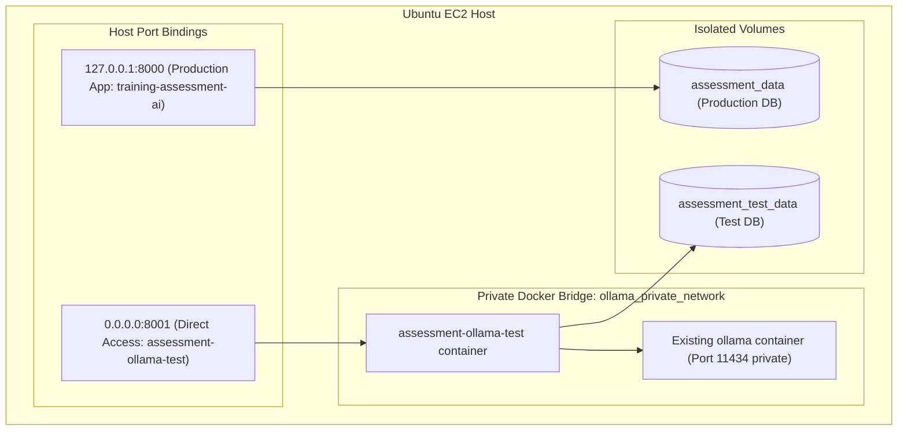

# Training Assessment AI Agent

A trainer-reviewed MCQ assessment web app built with Python 3.12, FastAPI, Jinja2, SQLAlchemy/SQLite, and Ollama (locally hosted Qwen model). It supports PDF, PPTX, DOCX, TXT, and Markdown source material, draft editing, secure published links, deterministic server-side grading, duplicate-submission prevention, exam timer with auto-completion, trainee email whitelist restrictions, progress tables, and CSV export.

## What is included

- `app/main.py`: web routes, trainer login, CSRF checks, generation/publish/submit flows, exam timer, and email restriction checks.
- `app/question_generator.py`: Ollama REST API (`/api/chat`) structured-output generation with JSON schema enforcement and bounded retries.
- `app/document_service.py`: source text extraction; scanned PDFs requiring OCR are rejected with a clear message.
- `app/schemas.py`: Pydantic validation of question and option structures.
- `app/assessment_service.py`, `app/grading_service.py`, `app/report_service.py`: publishing, secure token hashing, grading, CSV.
- `app/models.py`, `app/database.py`: SQLite persistence under `/app/data` in Docker.
- `app/templates/`, `app/static/`: responsive trainer and trainee UI.
- `tests/`: offline unit tests; mocked Ollama HTTP calls.
- `scripts/check_ollama_connection.py`: live Ollama connectivity and model check that safely tests generation without exposing secrets.

## Requirements

- Docker Engine and Docker Compose plugin (recommended for deployment).
- Ollama service running locally or as a container (provided in `compose.yaml`).
- Sufficient compute resources (GPU or CPU with adequate RAM) to run the selected Qwen model (e.g., `qwen2.5:7b` requires ~5GB of RAM/VRAM).
- Python 3.12 (if running locally without Docker).

## Run locally without Docker

Use Python 3.12 and ensure Ollama is installed and running (`ollama serve`):

```bash
# Pull the desired model in Ollama (if running local Ollama daemon)
ollama pull qwen2.5:0.5b-instruct

# Setup Python environment
python3.12 -m venv .venv
source .venv/bin/activate
python -m pip install --upgrade pip
pip install -r requirements.txt
cp .env.example .env

# Generate secret key
python -c 'import secrets; print(secrets.token_urlsafe(48))'
# Put the generated value into APP_SECRET_KEY in .env.
# LLM_PROVIDER defaults to ollama
# OLLAMA_BASE_URL defaults to http://localhost:11434 for local runs
# OLLAMA_MODEL defaults to qwen2.5:0.5b-instruct
# Set a strong APP_ADMIN_PASSWORD in .env.

set -a; source .env; set +a
uvicorn app.main:app --host 127.0.0.1 --port 8000
```

Open `http://127.0.0.1:8000`. Trainer routes redirect to `/login`; use `APP_ADMIN_PASSWORD` from `.env`. The database defaults to `./data/assessment.db` for local runs.

## Isolated Docker Compose test deployment on Ubuntu EC2 (Port 8001)

This configuration runs the Ollama assessment app as an **isolated test deployment** alongside the existing production application.

### Key Isolation Guarantees:
- **Port Isolation:** The test container binds to host port `8001` (`0.0.0.0:8001:8000`), allowing direct browser access while keeping the existing production application running undisturbed on port `8000`.
- **Container Isolation:** The test container is named `assessment-ollama-test` (separate from `training-assessment-ai`).
- **Data Isolation:** Persists data to a dedicated named volume `assessment_test_data` (does not touch or overwrite `assessment_data`).
- **Network & Ollama Reuse:** Connects to the existing EC2 `ollama` container over a private Docker bridge network (`ollama_private_network`). Ollama port `11434` is **never** exposed publicly or on the host. No duplicate Ollama container is created on EC2.

---

### 1. Configure test environment secrets

On the EC2 host:

```bash
cd /path/to/test-deployment-dir
cp .env.example .env
chmod 600 .env
python3 -c 'import secrets; print(secrets.token_urlsafe(48))'
```

Edit `.env` and set at minimum:

```dotenv
LLM_PROVIDER=ollama
OLLAMA_BASE_URL=http://ollama:11434
OLLAMA_MODEL=qwen2.5:0.5b-instruct
OLLAMA_TIMEOUT_SECONDS=120
APP_ENV=production
APP_SECRET_KEY=replace_with_output_from_secrets_token_urlsafe
APP_ADMIN_PASSWORD=replace_with_a_long_unique_password
SESSION_HTTPS_ONLY=true
```

> **Optional OpenAI Provider:** If you wish to test with OpenAI instead, set `LLM_PROVIDER=openai`, `OPENAI_API_KEY=your_key`, and `OPENAI_MODEL=gpt-4o-mini`. When `LLM_PROVIDER=ollama` (default), no OpenAI API key is needed.

---

### 2. Build and start the test container

```bash
docker compose config
docker compose build --pull
docker compose up -d
docker compose ps
```

---

### 3. Connect existing EC2 `ollama` container to the private network

On EC2, attach the existing running `ollama` container to the private network:

```bash
# Attach existing ollama container to the private bridge network
docker network connect ollama_private_network ollama
```

> **Note:** Inside `ollama_private_network`, `assessment-ollama-test` resolves the container by its name `ollama` at `http://ollama:11434`. Port 11434 remains unexposed to the host and WAN.

---

### 4. Verify test application health and Ollama connectivity

Check container logs and health check:

```bash
docker compose logs --tail=100 assessment-ollama-test
curl --fail http://127.0.0.1:8001/health
```

Run the non-destructive diagnostic script inside the test container:

```bash
docker compose exec assessment-ollama-test python scripts/check_ollama_connection.py
```

This verifies private reachability of the `ollama` container, checks that `qwen2.5:0.5b-instruct` is loaded, and runs a test generation without logging any secrets.

---

### 5. Access the test web interface directly in your browser

You can open the test application directly in your web browser at:

```
http://<EC2_PUBLIC_IP>:8001
```

(The production application remains available concurrently on port 8000).

> [!IMPORTANT]
> **EC2 Security Group Inbound Rule (Restrict to Trusted IP):**
> In your AWS EC2 Management Console, add an inbound rule to the instance's Security Group:
> - **Type:** Custom TCP
> - **Port Range:** `8001`
> - **Source:** Your own public IP address / trusted CIDR (e.g. `203.0.113.25/32`, or select **My IP** in the AWS console dropdown).
>
> **Do not open port 8001 to `0.0.0.0/0` (Anywhere).** Restricting access to your trusted IP prevents unauthorized internet users from reaching trainer endpoints or submitting assessments while allowing you to test directly from your browser without an SSH tunnel.

---

## Tests and validation

Offline unit tests use mocked Ollama HTTP responses and do not require a live Ollama daemon:

```bash
python -m pip install -r requirements.txt
python -m py_compile app/*.py scripts/*.py tests/*.py
pytest -v
```

Compose/build validation:

```bash
docker compose config
docker compose build
```

## Main workflow

1. Trainer logs in.
2. Trainer enters a topic, source notes or uploads training material, sets question count, difficulty, trainee email whitelist, and optional exam duration.
3. The local Ollama Qwen model generates a structured JSON draft using only the supplied source as evidence.
4. Trainer edits questions, options, correct answers, and explanations, then saves and approves.
5. Publish creates a cryptographically random link. Only its SHA-256 hash is stored; the raw link is shown once and can be rotated to invalidate the prior link.
6. Trainees access the link, enter their whitelisted email, and start the timed assessment.
7. Trainees submit answers or are auto-submitted when the timer expires. The server deterministically grades against the stored answer key; client-supplied scores are never accepted. A unique constraint prevents duplicate submissions for the same email.
8. Trainer reviews submissions and exports CSV.

## Troubleshooting

- **Login is not configured:** set `APP_ADMIN_PASSWORD` and restart with `docker compose up -d --force-recreate`.
- **Session errors after deployment:** set a stable random `APP_SECRET_KEY`; all replicas must share it. Use HTTPS and `SESSION_HTTPS_ONLY=true` when behind correctly configured TLS.
- **Ollama connection failure:** confirm the `ollama` service is healthy (`docker compose ps`). Check that `OLLAMA_BASE_URL` in `.env` is set to `http://ollama:11434` for Docker Compose or `http://localhost:11434` for local runs.
- **Ollama model not found (404):** pull the model in the Ollama container (`docker compose exec ollama ollama pull qwen2.5:7b`) and ensure `OLLAMA_MODEL` in `.env` matches the pulled tag.
- **Generation timeout:** local LLM inference speed depends on host hardware (CPU/GPU). If generation times out on larger source materials, increase `OLLAMA_TIMEOUT_SECONDS` (e.g. 180 or 300) in `.env` and restart.
- **Missing dependency/import:** `docker compose build --no-cache && docker compose up -d` and inspect `docker compose logs --tail=200`.
- **Port already in use:** `sudo ss -ltnp | grep ':8000'`; change the host-side port in Compose if necessary.
- **Cannot connect externally:** with the default binding, external access is intentionally blocked. Use SSH tunnel/reverse proxy, or temporarily publish `8000:8000` with a narrowly scoped security-group rule.
- **Database permission error:** named volume is `assessment_data`; inspect `docker compose exec assessment-app id` and `docker volume ls`. Avoid changing ownership blindly on a live volume.
- **Syntax error:** `python -m py_compile app/*.py scripts/*.py tests/*.py`; then review the reported filename and line.

## Rollback and Test Cleanup Procedure

To remove or stop the isolated test deployment without affecting the production port-8000 application:

1. **Stop the test container:**
   ```bash
   docker compose down
   ```
2. **Disconnect the existing `ollama` container from the test network (if cleaning up network):**
   ```bash
   docker network disconnect ollama_private_network ollama
   ```
3. **(Optional) Remove isolated test volume:**
   ```bash
   docker volume rm assessment_test_data
   ```
4. **Verification:**
   Confirm that the production container `training-assessment-ai` on port 8000 and the `ollama` container are still running normally:
   ```bash
   docker ps
   curl --fail http://127.0.0.1:8000/health
   ```

## Backup and upgrades

Back up SQLite before changing versions or schema:

```bash
mkdir -p backups
docker compose stop assessment-ollama-test
docker run --rm -v assessment_test_data:/data -v "$PWD/backups:/backup" alpine sh -c 'cp /data/assessment.db /backup/assessment-$(date +%Y%m%d-%H%M%S).db'
docker compose up -d
```

The volume name may be prefixed by your Compose project name; confirm it with `docker volume ls`. Store backups encrypted and restrict access because they contain trainee identifiers and results. Restore only with the app stopped and after preserving the current database.

## Data retention and limitations

- The app stores assessment source text, question keys, trainee name/identifier, answers, scores, and timestamps in SQLite. Define a retention period appropriate to your organization and delete old data/backups securely.
- OCR is not implemented. Scanned/image-only PDFs are rejected with an explicit message.
- The time limit is enforced against a signed browser session timestamp; it is a baseline control, not a high-assurance proctoring system. Server-side session persistence across devices is not implemented.
- Trainer access uses one shared password rather than individual accounts, roles, MFA, or password reset. Add enterprise identity management before broad production use.
- Add rate limiting at a reverse proxy, audit logging, database migrations, automated encrypted backups, monitoring, and security review before handling sensitive/high-volume assessments.
- No email delivery is implemented; trainer shares the assessment URL manually.
- Model output can still contain mistakes. Trainer review before publishing is mandatory.

## Architecture



## Production hardening checklist

- [ ] HTTPS reverse proxy/load balancer and security-group least privilege.
- [ ] Individual trainer identities, MFA/SSO, and authorization per assessment.
- [ ] Reverse-proxy rate limiting and request-size limits.
- [ ] Database migration strategy and encrypted, tested backups.
- [ ] Retention/deletion policy and privacy notice.
- [ ] Monitor errors, API costs, rate limits, and container health.
- [ ] Validate configured model access and API billing.
- [ ] Review accessibility and security with representative users.
